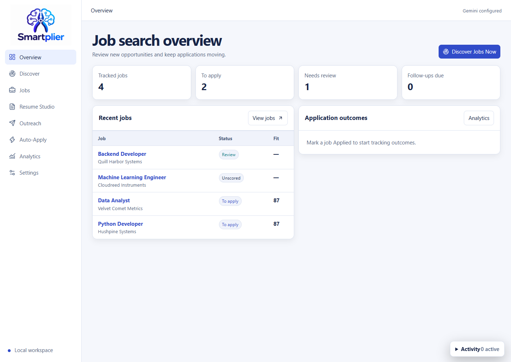
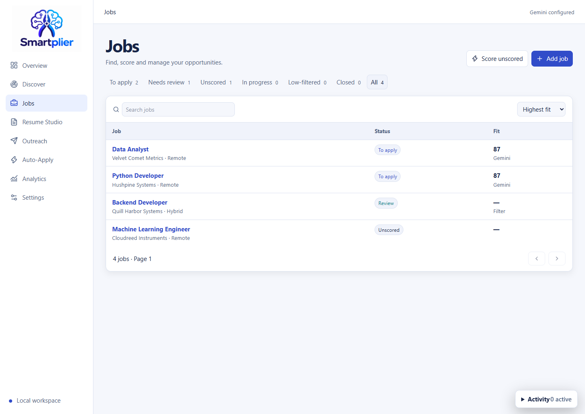
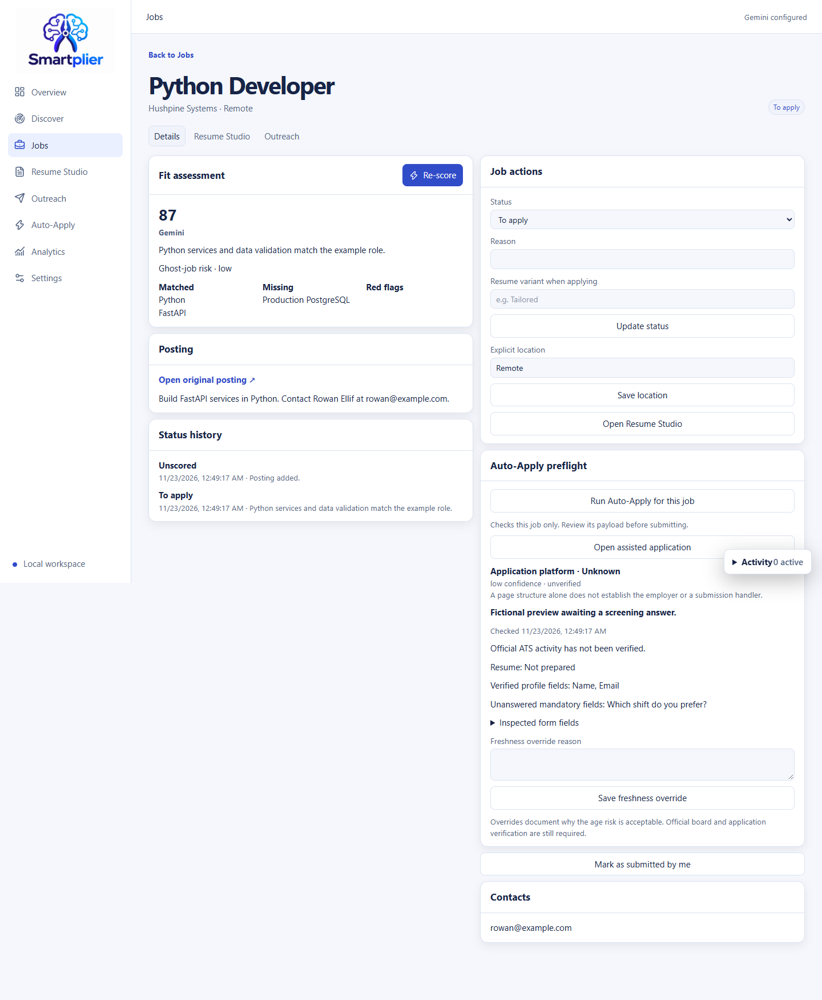
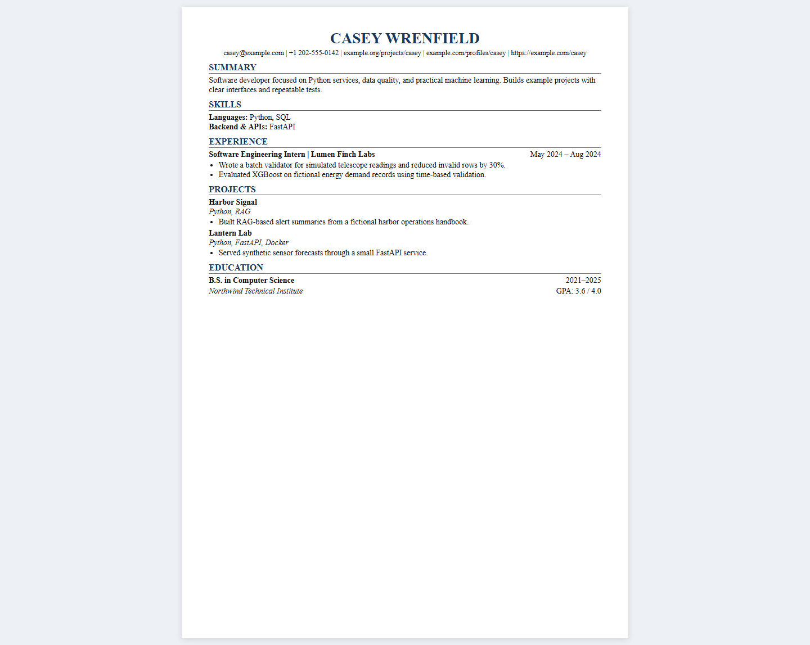
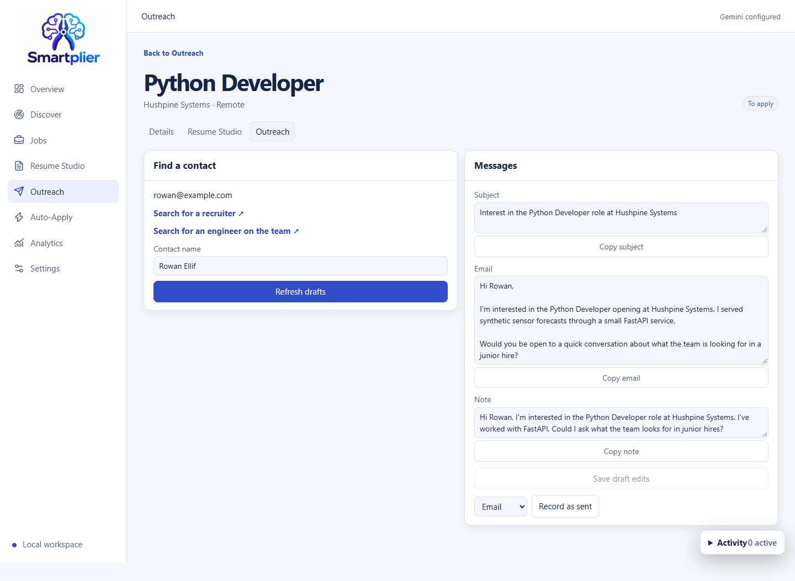
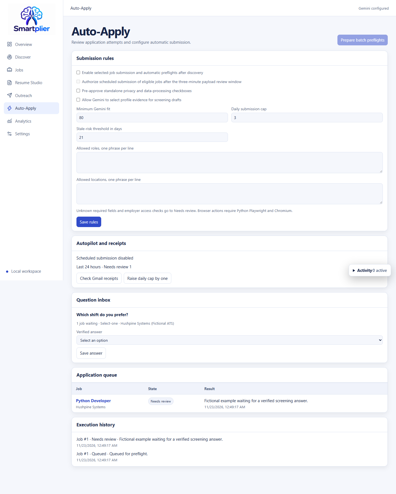
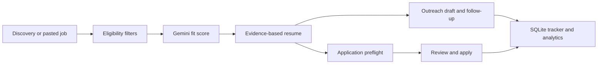

# SmartPlier

A local job-application workspace for finding relevant roles, tailoring evidence-based resumes, and tracking outreach and applications.




## Why Smartplier exists

Applying jobs selectively takes time and effort. Smartplier connects discovery, fit assessment, resume tailoring, outreach, and tracking so you can review the evidence behind a decision before applying. It is designed for individual workflows with local storage and configurable review gates.

## Demo

Run `smartplier demo` after building the frontend, then open [the demo dashboard](http://127.0.0.1:8011/). The demo uses a temporary database, fictional jobs and profile evidence, and mock scoring. It requires no API key. The dashboard labels the same scoring features used in normal mode, including the mock scores and provider indicator.

| | |
| --- | --- |
| [](docs/images/02-jobs.png) | [](docs/images/03-job-detail.png) |
| [](docs/images/04-resume.png) | [](docs/images/05-outreach.png) |
| [](docs/images/06-auto-apply.png) | |

The screenshots come from the demo command. Run `node frontend/capture-demo.mjs` to reproduce them with Chrome. Set `BROWSER_CHANNEL=chromium` to use Playwright's installed Chromium instead.

## Features

### Implemented

- Paste and track jobs locally. Import from public ATS boards, RSS, Adzuna, or Gmail alerts. Record source and status history in SQLite.
- Check hard eligibility rules, then score eligible jobs with Gemini. Review matched and missing requirements, red flags, and an estimate of ghost-job risk.
- Tailor resumes from profile evidence. Preview printable HTML and download LaTeX. Reuse cached results for unchanged inputs.
- Find posting contacts, draft outreach messages for manual sending, and track replies and follow-ups.
- Review screening questions in a shared inbox. Reuse verified answers when the applicable question and choices match.
- Inspect supported employer forms and preview the outbound payload. Submit one reviewed job, use assisted mode, or explicitly authorize scheduled submission. Track attempts, confirmation evidence, and status.
- Summarize recorded applications and replies by role, source, score band, and resume variant.

| ATS | Public discovery | Official listing verification in Auto-Apply | Generic form submission |
| --- | --- | --- | --- |
| Lever | Implemented | Implemented | Eligible standard forms, tested with local fixtures |
| Workable | Implemented | Implemented | Eligible standard forms, tested with local fixtures |
| Greenhouse | Implemented | Pending | Eligible standard forms, tested with local fixtures |
| Ashby | Implemented | Pending | Eligible standard forms, tested with local fixtures |
| Other employer sites | Paste a posting, or use a configured source | Depends on the board. Older listings without a verification path need review. | Eligible same-origin standard forms, including a custom local fixture |

The fixture tests exercise the generic form engine with representative markup. Live ATS compatibility varies by employer form, age signals, access checks, and confirmation email format.

### In progress

- Live employer compatibility and real Gmail confirmation matching are unverified.
- Forms that rely on JavaScript, submit personal data in an intermediate step, use cross-origin widgets, or present access checks need manual handling.
- Outreach messages are sent by the user. Analytics require actual recorded outcomes.

## How it works



The form engine tries a cached recipe, asks Gemini to classify a new layout, then routes unresolved fields and unsupported flows to assisted mode. Gemini's planning prompt contains sanitized field metadata. Verified answers and applicant details are resolved locally. See [Architecture](docs/ARCHITECTURE.md).

## Safety and ethics

- Auto-Apply starts disabled. Scheduled submission requires a separate opt-in and provides a three-minute payload review window. Daily caps, duplicate checks, freshness rules, and ghost-job risk checks apply.
- A preflight displays the destination and field values. A changed payload stops submission. Smartplier reserves a submission before sending and holds uncertain outcomes without automatically retrying.
- Unknown mandatory questions and legal attestations go to review. A narrowly matched, standalone privacy checkbox can use an explicit standing policy.
- Smartplier stops at CAPTCHA, bot protection, and access checks. LinkedIn, Indeed, and Naukri enter through Gmail alerts or pasted postings.
- Resume claims come from the user's own profile evidence. Review extracted information, drafts, and eligibility before using them.
- Use at your own risk. Respect each site's terms and the employer's application process.

## Requirements and setup

- Python 3.10 or later and Node.js 22 or later with npm.
- A source checkout and a Python editable installation.
- Playwright and Chromium for browser workflows. An existing Chrome installation can be used on Windows.
- A Gemini key for real scoring and generation. A Gmail app password is optional for alerts and receipt checks.
- Windows Credential Manager and the `Launch Smartplier.cmd` launcher are Windows-only. Environment variables work on all platforms.

### Windows PowerShell

From the repository root:

```powershell
python -m venv .venv
.\.venv\Scripts\python.exe -m pip install -e '.[browser]'
npm --prefix frontend ci
npm --prefix frontend run build
.\.venv\Scripts\python.exe -m playwright install chromium
.\.venv\Scripts\smartplier.exe init
.\.venv\Scripts\smartplier.exe demo
```

With Google Chrome installed, you can replace the Chromium install step with `$env:SMARTPLIER_BROWSER_CHANNEL = 'chrome'` and `$env:BROWSER_CHANNEL = 'chrome'` in the current terminal.

### macOS and Linux

```sh
python3 -m venv .venv
. .venv/bin/activate
python -m pip install -e '.[browser]'
npm --prefix frontend ci
npm --prefix frontend run build
python -m playwright install chromium
smartplier init
smartplier demo
```

If Linux is missing browser system libraries, run `python -m playwright install --with-deps chromium`. Open the printed local URL. Stop the demo with **Ctrl+C**.

## Usage

`smartplier init` creates `profile.json` and `discovery.json` from fictional examples and preserves existing files. Edit the local configuration before scoring real jobs. To start the production dashboard, run `smartplier web` and open [the dashboard](http://127.0.0.1:8010/). The Windows launcher uses the project virtual environment if available.

The console command and the root `jobhunt.py` wrapper expose the same CLI.

```sh
smartplier add --title "Python Developer" --company "Example Studio" --location Remote --description "Build Python services."
smartplier list
smartplier score --id 1
smartplier show 1
smartplier resume 1
smartplier outreach draft 1
smartplier analytics
python jobhunt.py web
python jobhunt.py serve
```

Open **Auto-Apply** to set submission rules and review the **Question Inbox**. From a single job, run preflight and review the payload before using **Submit this job only**. **Open assisted application** lets you review a partially filled form or use the employer's page manually. Scheduled submission is optional.

## Configuration

| Area | Where to configure it |
| --- | --- |
| Profile | `profile.json` holds contact details, preferences, skills, education, experience, projects and stories. Experience and project bullets use stable IDs. Stories refer to those IDs. |
| Discovery | `discovery.json` holds `companies`, `rss`, `adzuna`, `gmail`, and `filter_target_roles`. A company entry needs a provider, board slug, and display name. An RSS entry needs a name and HTTPS URL. |
| Dashboard options | The active SQLite database stores settings, status history, source runs, and outcome records. |
| Auto-Apply | Configure minimum fit (default 80), role/location filters, stale-risk age (21 days), and daily attempt cap (3). An older posting needs official verification and a reasoned override. |
| Local artifacts | SQLite files, resumes, and application evidence can contain applicant details. Keep them private. |

Set secrets in your shell environment. `.env.example` is a reference for variable names. Smartplier reads the process environment directly. On Windows, `smartplier setup-gemini` and `smartplier setup-gmail` can save credentials through hidden prompts in Windows Credential Manager.

| Variable | Use |
| --- | --- |
| `GEMINI_API_KEY` | Gemini scoring and generation |
| `GMAIL_USER`, `GMAIL_APP_PASSWORD` | Optional read-only Gmail alert and receipt checks |
| `ADZUNA_APP_ID`, `ADZUNA_APP_KEY` | Optional Adzuna discovery |
| `SMARTPLIER_BROWSER_CHANNEL` | Optional Python Playwright browser channel, for example `chrome` |
| `SMARTPLIER_NO_BROWSER` | Start the Windows launcher without opening a tab |
| `PYTHON` | Python executable for the frontend browser test and screenshot tools |
| `BROWSER_CHANNEL` | Frontend Playwright browser channel, default `chrome` |

## Testing

From the repository root, use the same Python environment that installed Smartplier.

```sh
python -B -m unittest discover -q
npm --prefix frontend run build
npm --prefix frontend run test:browser
```

On Windows without activation, run `.\.venv\Scripts\python.exe -B -m unittest discover -q` and set `$env:PYTHON = (Resolve-Path .venv/Scripts/python.exe).Path` before the npm browser test. If using bundled Chromium for the frontend tests, run `npx --prefix frontend playwright install chromium` and set `BROWSER_CHANNEL=chromium` in your shell. Python browser tests require a Playwright browser and may be skipped when unavailable.

Tests cover scoring, discovery, local HTTP security, resume/output validation, outreach, analytics, form recipes and guards, scheduler controls, and mock submission followed by a mock Gmail receipt. Browser fixtures post only to a temporary local server.

Run `python -B scripts/check_no_secrets.py` before publication. Add `--reference <path-to-original-private-profile>` to check a known profile without printing values. The publishing check runs on every GitHub push and pull request. On Linux/macOS install Tesseract with English data for screenshot scanning. Windows can use its native OCR engine. Exact-line fixture exceptions cover mock URLs and senders used to exercise validation. An optional Gitleaks configuration is included.

## Project structure

```text
.
├── .github/workflows/  Automated checks
├── docs/               Architecture and fictional screenshots
├── examples/           Fictional profile and discovery configuration
├── frontend/           React, TypeScript, Vite, and browser tools
├── scripts/            Publication scanner and image OCR support
├── src/smartplier/      Python application and legacy dashboard assets
├── tests/              Regression tests and fictional fixtures
├── jobhunt.py          Source-checkout CLI wrapper
├── Launch Smartplier.cmd
└── pyproject.toml
```

## Limitations and roadmap

This is a local, single-user project. The browser engine handles standard, same-origin forms with bounded navigation. Additional official-board verification, broader form compatibility, and live employer receipt matching are areas for future verification. A confirmation screen can leave a job **Probable** until a matching receipt arrives or you confirm it manually.

## Contributing and license

Use fictional fixtures for contributions and run the tests and publication scanner before proposing changes. Avoid including applicant data, credentials, employer receipts, and live submission activity in tests.

Smartplier is distributed under the [MIT License](LICENSE).
